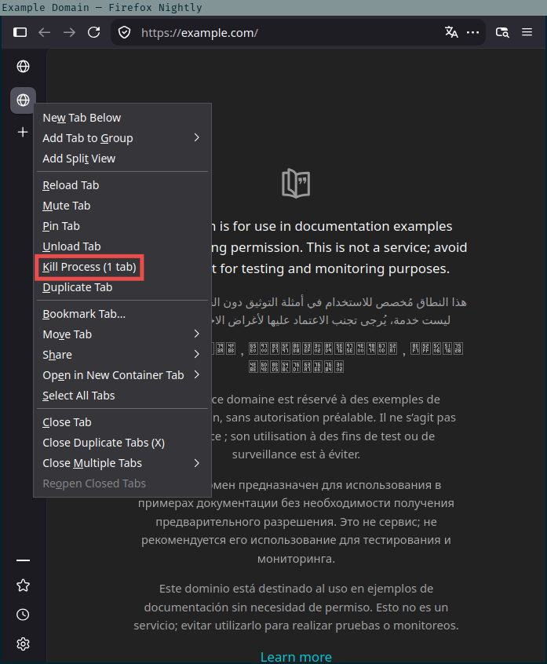
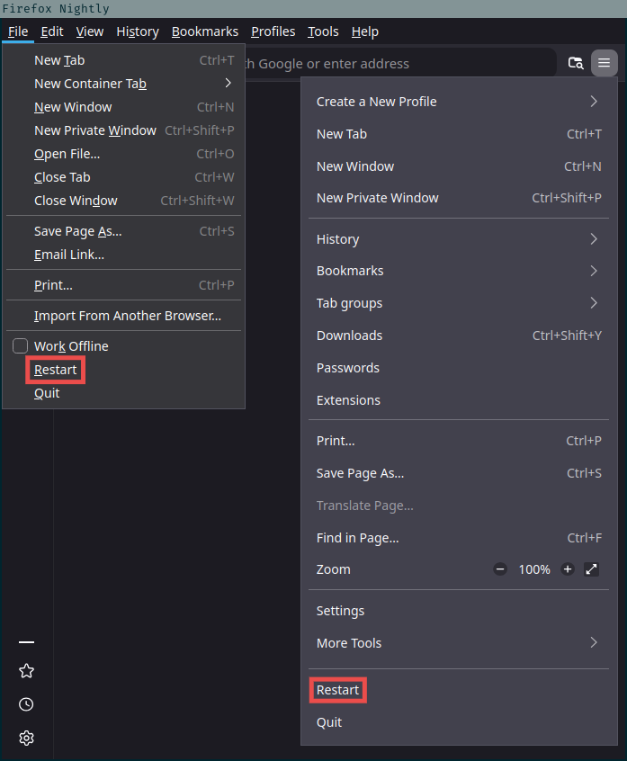

An [AutoConfig](https://support.mozilla.org/kb/customizing-firefox-using-autoconfig) script that adds [Kill Process](#kill-process) to Firefox tabs and [Restart](#restart) to Firefox windows.

## Kill Process
Adds a *Kill Process* menu item below *Unload Tab* in the tab context menu. It kills the tab's content process in the same way as the kill button in `about:processes`, which ends a hung, stuck or thrashing content process.

Killing the process also takes down every other tab and frame that belongs to it. Each affected tab will show the crashed-tab page, from which it can be restored.

The item is hidden for tabs without a content process of their own, such as unloaded tabs and `about:` pages that run in the main process.



| Pref                                    | Default | Effect                                |
| --------------------------------------- | ------- | ------------------------------------- |
| `browser.tabs.killProcessInContextMenu` | `true`  | Show the item in the tab context menu |

## Restart
Adds a *Restart* menu item above *Quit* in the File menu (<kbd>Alt</kbd>+<kbd>F</kbd>) and in the app menu (☰). By default it asks for confirmation first.



The preferences are the same as Waterfox's.

| Pref                                    | Default | Effect                                           |
| --------------------------------------- | ------- | ------------------------------------------------ |
| `browser.restart_menu.requireconfirm`   | `true`  | Ask for confirmation before restarting           |
| `browser.restart_menu.purgecache`       | `false` | Clear the startup cache, as `about:support` does |
| `browser.restart_menu.showpanelmenubtn` | `true`  | Show the item in the File menu and the app menu  |

## Install
The operator must have superuser access. Changes take effect after Firefox restarts.

`install.sh` lists every known Firefox install it finds in a checklist and installs into the checked ones. It requires `dialog`.

```sh
sudo ./install.sh
```

### Manual install
Find your Firefox binary directory and substitute for `FFDIR`:

```sh
FFDIR=/usr/lib64/firefox
sudo install -m 644 autoconfig.js "$FFDIR/defaults/pref/autoconfig.js"
sudo install -m 644 autoconfig.cfg "$FFDIR/autoconfig.cfg"
sudo install -d -m 755 "$FFDIR/autoconfig"
sudo install -m 644 autoconfig/restart.cfg "$FFDIR/autoconfig/restart.cfg"
sudo install -m 644 autoconfig/kill-process.cfg "$FFDIR/autoconfig/kill-process.cfg"
```

## Uninstall

```sh
FFDIR=/usr/lib64/firefox
sudo rm "$FFDIR/defaults/pref/autoconfig.js"
sudo rm "$FFDIR/autoconfig.cfg"
sudo rm "$FFDIR/autoconfig/restart.cfg"
sudo rm "$FFDIR/autoconfig/kill-process.cfg"
sudo rmdir "$FFDIR/autoconfig"
```

## Troubleshooting
The scripts report errors in the Browser Console, opened with <kbd>Ctrl</kbd>+<kbd>Shift</kbd>+<kbd>J</kbd> or from the app menu (☰) under *More Tools* → *Browser Console*.
